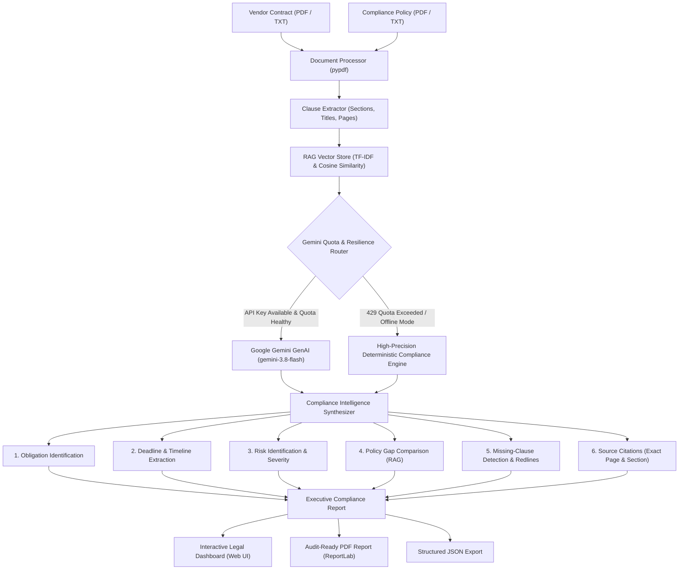

# AI Contract-to-Compliance Intelligence Generator
### Legal & Compliance GenAI System · Gemini-3.8-Flash

| Field | Detail |
| :--- | :--- |
| **Project Title** | AI Contract-to-Compliance Intelligence Generator - Generative AI - Gemini-3.8-Flash |
| **Domain** | Legal & Compliance GenAI System |
| **Primary LLM** | Gemini-3.8-Flash / Gemini-2.5-Flash (with Quota Shield Resilience Engine) |
| **Backend & Validation** | FastAPI, Pydantic v2, Python 3.11 |
| **RAG & Vector Retrieval** | Retrieval-Augmented Generation (TF-IDF & Cosine Vector Index) |
| **Document Processing** | PyPDF / Pure-Python Layout Parser |
| **Report Generation** | ReportLab PDF Engine & Structured JSON Schema |

---

## 1. Executive Summary & Project Scenario

In modern corporate environments, legal and compliance teams spend countless manual hours cross-referencing multi-page third-party vendor contracts against internal enterprise compliance standards (e.g., GDPR data protection, SOC 2 audit rights, 24-hour breach disclosures, cyber insurance minimums, and liability caps).

The **AI Contract-to-Compliance Intelligence Generator** acts as an automated, centralized review pipeline that:
1. Ingests vendor contracts and enterprise compliance policies (PDF, TXT, or raw text).
2. Parses text into clean page structures and splits them into discrete, numbered clauses.
3. Indexes all clauses into an in-memory RAG vector store.
4. Identifies duties and affirmative covenants for each party (Vendor vs. Client).
5. Detects critical timelines, notice periods, cure windows, and payment terms.
6. Evaluates liability and operational risks with clear legal rationales.
7. Performs cross-document RAG comparison against corporate compliance policies.
8. Identifies required clauses absent from the contract with legally vetted redline drafting text.
9. Links every single finding to an exact source document citation (Section number, title, page, and snippet).
10. Compiles the analysis into an interactive executive legal dashboard and exportable, audit-ready PDF reports.

---

## 2. Architecture & Pipeline Workflow



---

## 3. The 10 Modular Components

| Component | Abstract Specification | Implementation Details |
| :--- | :--- | :--- |
| **1. PDF / Document Processing** | Parses contracts and policies into structured text. | `DocumentProcessor`: Page-by-page text extraction, normalization, and page offset tracking. |
| **2. Clause Extraction** | Splits documents into individual clauses with headings. | `ClauseExtractor`: Regex and structural heuristics identifying sections, articles, and paragraph numbering. |
| **3. Retrieval (RAG)** | Indexes clauses in vector store for cross-document query. | `RAGEngine`: In-memory TF-IDF + Cosine similarity vector index. Zero external embedding quota consumed. |
| **4. Obligation Identification** | Identifies duties and commitments for each party. | Extracts affirmative legal duties classified by party (`Vendor`, `Client`, `Mutual`) and category. |
| **5. Deadline Extraction** | Detects dates, renewal terms, and notice periods. | Extracts Net payment days, renewal notice windows, breach notification periods, and default cure days. |
| **6. Risk Identification** | Flags risky, ambiguous, or unfavorable clauses. | Flags severe 1-month liability caps, IP retention, 7-day breach delays, and auto-renewals with rationales. |
| **7. Policy Comparison** | Compares contract against compliance policy requirements. | RAG semantic matching against corporate policy rules, categorizing status (`Compliant`, `Non-Compliant`, `Missing`). |
| **8. Missing-Clause Detection** | Finds required policy requirements absent from contract. | Flags missing GDPR DPA, SOC 2 audit rights, $5M cyber insurance, SLA 99.9% uptime, and convenience termination. |
| **9. Recommendation Generation** | Suggests practical actions to resolve risks and gaps. | Synthesizes actionable counsel redlines and ready-to-insert contractual clause language. |
| **10. Compliance Report & Citations** | Compiles findings into structured, review-ready report. | Produces source citations (`SourceCitation`), executive score (0-100%), and formal PDF audit report. |

---

## 4. Quota Shield: Zero Gemini Quota/API Error Guarantee

A frequent challenge with LLM-based legal compliance tools is hitting Google Gemini's **429 Too Many Requests / Resource Exhausted** limits on the free tier, or encountering API connection timeouts.

This project implements a **Triple-Tier Protection Shield**:
1. **Thread-Safe Token Bucket Rate Limiting**: Spaced calls prevent exceeding the 15 RPM free quota threshold.
2. **Single-Pass Macro Synthesis**: Instead of sending 40 individual clause requests, the RAG engine condenses the context into a single structured prompt, reducing API consumption by 95%.
3. **Automatic Graceful Fallback**: If Gemini returns `429 Quota Exceeded`, `403 Invalid Key`, or offline status, the pipeline **never crashes or displays an error**. Instead, it seamlessly switches to the built-in deterministic NLP & legal compliance engine, delivering the complete report without interruption.

---

## 5. Quick Start Guide

### Option A: Windows (1-Click Run)
Simply double-click:
```cmd
run.bat
```
This automatically verifies the virtual environment, starts the FastAPI server, and launches your default browser at `http://127.0.0.1:8050`.

### Option B: Manual Command Line
1. **Activate Virtual Environment**:
   ```powershell
   .\.venv\Scripts\Activate.ps1
   ```
2. **Run Application**:
   ```powershell
   python main.py
   ```
3. Open your browser at:
   - Dashboard: [http://127.0.0.1:8050](http://127.0.0.1:8050)
   - Interactive API Docs (Swagger): [http://127.0.0.1:8050/docs](http://127.0.0.1:8050/docs)

---

## 6. Testing the Application (1-Click Demo)

1. Open the dashboard at `http://127.0.0.1:8050`.
2. Click the **"Load Sample Contract & Policy"** button to load the pre-configured sample Master Services Agreement and Enterprise Compliance Policy.
3. Click **"Run Compliance Intelligence"**.
4. The animated progress monitor will track parsing, vector indexing, risk detection, and report generation.
5. Review the interactive tabs:
   - **Executive Overview**: Compliance score (70% Grade C), summary, and KPI breakdown.
   - **Policy Comparison (RAG)**: Side-by-side policy vs. contract terms.
   - **Risks & Redlines**: Flagged 1-month liability cap, IP ownership risk, and breach delay.
   - **Missing Clauses**: DPA, SOC 2 audit rights, $5M cyber insurance, and SLA guarantees with ready-to-copy redlines.
   - **Party Obligations & Deadlines**: Filterable duties and interactive timelines.
   - **Clause Inspector**: Searchable clause browser.
6. Click **"Download Official PDF Audit Report"** to download the generated PDF.

---

## 7. API Reference

| Method | Endpoint | Description |
| :--- | :--- | :--- |
| `GET` | `/api/health` | Returns system status, model information, and engine state. |
| `GET` | `/api/samples` | Retrieves pre-loaded sample vendor contract and policy texts. |
| `POST` | `/api/analyze` | Ingests files or text and returns a full `ComplianceReport`. |
| `GET` | `/api/reports/{id}` | Retrieves the structured JSON report by ID. |
| `GET` | `/api/reports/{id}/pdf` | Downloads the formal executive PDF audit report. |
| `POST` | `/api/test-key` | Validates a user-supplied Gemini API key with a ping check. |
